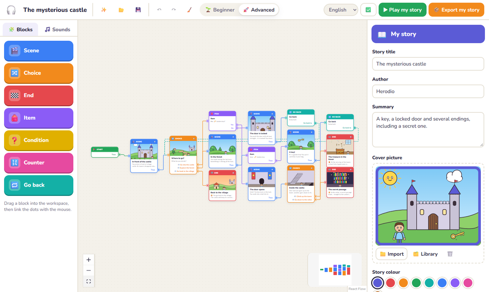
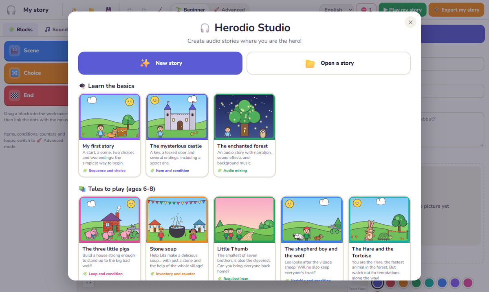
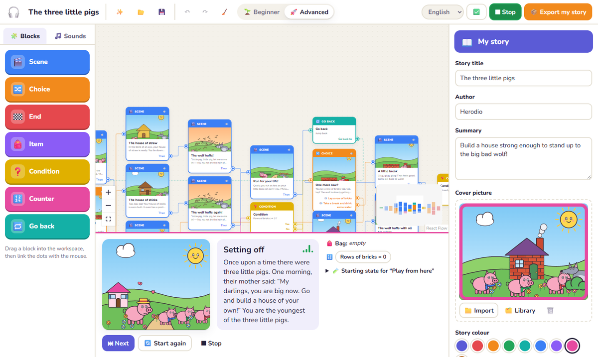
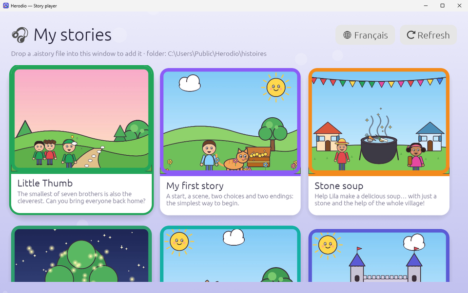
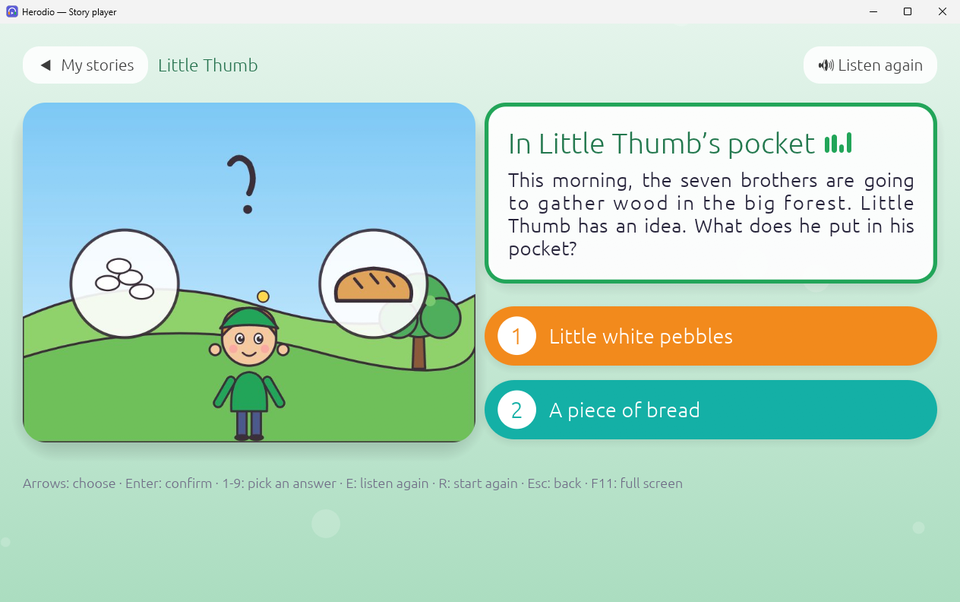
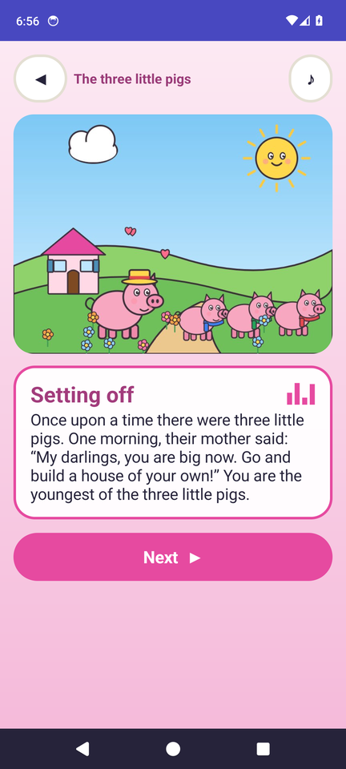

# Herodio — a studio for audio stories where you are the hero

*[Version française](README.md)*

Herodio lets a child (roughly 7 to 14 years old), a teacher or a youth leader **create an interactive audio story without writing any code**. You link coloured blocks together, record your voice, add sound effects and background ambience, then play the story. Finally, you export it to a PC, a Raspberry Pi or an Android phone, recent or very old.

Everything works **offline**, with no account and no subscription.

> **Version 0.2.2-alpha**: a test version, in French and English. The Studio and the PC and Android players are tested; a real Raspberry Pi has not been tried on the device yet; first tries on a real Xperia Play and a smartphone led to the Android fixes in 0.2.2, to be checked again on the device (see [Project status](#project-status)).

## Preview


<sub>The Studio: link colourful blocks to build the story (here “The mysterious castle”).</sub>

<table>
<tr>
<td width="50%"><br><sub>The Studio’s home screen: 8 stories ready to play or change.</sub></td>
<td width="50%"><br><sub>Try your story right inside the Studio.</sub></td>
</tr>
<tr>
<td><br><sub>The PC and Raspberry Pi player: the library.</sub></td>
<td><br><sub>A choice to make: the text and then each answer are read aloud.</sub></td>
</tr>
</table>

<p align="center"><br><sub>The Android player, here on Android 14 (it also runs on an Xperia Play with Android 2.3).</sub></p>

## Download

All the files are on the [Releases](https://github.com/RyoSaeba89/herodio/releases) page:

| File | What it is for |
|---|---|
| `herodio-studio-…-windows-portable.exe` | **Herodio Studio**, the editor: a single file to run, nothing to install (Windows 10/11, WebView2). French and English voices, 8 stories in each language. |
| `herodio-player-…-windows.exe` | Player for Windows PCs |
| `herodio-player-…-linux-x64.tar.gz` | Player for Linux PCs |
| `herodio-player-…-raspberry-pi-arm64.tar.gz` | Player for Raspberry Pi 3, 4, 5 or Zero 2 (64-bit Raspberry Pi OS), with the autostart files |
| `herodio-android-….apk` | Android player, from 2.3 (Xperia Play) to 14 |
| `stories-en-pc-android-raspberry-pi.zip` | The 8 stories in English, ready to play (PC, Raspberry Pi, recent Android) |
| `stories-en-android23.zip` | The 8 English stories, lightened for Android 2.3 |
| `histoires-….zip` | The same 8 stories in French, for the same devices |

How to install each player is described in [docs/lecteurs.en.md](docs/lecteurs.en.md). `SHA256SUMS.txt` lets you check the downloads.

## What you can do

- **In French and English**: on first launch, the Studio and every player ask for the interface language; you can change it at any time. The 8 stories that come with Herodio exist in both languages, each with its own narration.
- **Block editor** in the spirit of Scratch:
  - the blocks: Start, Scene, Choice and End, plus, in 🚀 Advanced mode, Item, Condition, Counter and Go back;
  - drag and drop, linking with the mouse (dropping an arrow on empty space offers to create the next block), right-click menu, zoom, automatic tidying;
  - undo / redo, automatic saving and recovery after an accidental close.
- **Microphone recording** on every scene, question or answer: several takes, instant playback, choice of take.
- **Audio studio** (a "mini-Audacity" for children):
  - waveform, selecting a piece, cut, delete, keep only a piece, move;
  - louder / quieter, best volume (normalisation), fade in and fade out, crossfade;
  - voice, ambience and sound-effect tracks, with mute, solo and volume;
  - the ambience is lowered automatically when someone speaks (ducking).
- **Sound and image library**: import WAV, MP3, OGG, FLAC or M4A, and PNG, JPEG, WebP or SVG; categories; preview; drag a sound or an image onto a block; unused media are flagged.
- **Pictures**: every scene, question or ending can have its own picture. The story also has a cover and a colour. On export, images are converted to JPEG at the right size for each device.
- **Automatic voice** (off by default):
  - a **free, offline** synthetic voice reads aloud the texts that have no recording yet: scenes, questions and answers;
  - it is based on [Piper](https://github.com/rhasspy/piper): the "Siwis" voice for stories in French, "LJ Speech" for stories in English ("Story language" setting);
  - it works in the preview and is built into the sounds on export: **all** players benefit, even Android 2.3;
  - a block's 🗣️ button turns it into a real take that you can edit in the studio.
- **"Play my story"** with the same engine as the players:
  - the current block is highlighted, and so is the path taken;
  - the bag and the counters are shown;
  - you can play from any block, with a chosen starting state.
- **Story check** in child-friendly language: missing start, missing arrow, block never reached, dead end, endless loop, item never given, sound not found…
- **One-click export** to 5 platforms, with a size estimate and advice for each device.
- **8 stories included**, all narrated, illustrated and with sound:
  - 3 to learn the tool: *My first story*, *The mysterious castle*, *The enchanted forest*;
  - 5 classic tales for **ages 6-8**, studied then adapted into interactive stories: *The three little pigs*, *Stone soup*, *Little Thumb*, *The shepherd boy and the wolf*, *The Hare and the Tortoise*. The study and the adaptation choices are in [docs/histoires/analyse.en.md](docs/histoires/analyse.en.md).
- **Illustrated, colourful players**:
  - a library of cards with covers;
  - a large picture and a background in the story's colours;
  - answers as big, coloured, numbered buttons; the text and then each answer are read one after the other, with what is being read highlighted;
  - fades between scenes;
  - confetti (happy ending) or a shower of stars (secret ending).

## Project status

This table separates what is written, built and tested:

| Component | Implemented | Built | Tested |
|---|---|---|---|
| Editor (Windows, Tauri) | ✅ | ✅ portable exe + NSIS installer | ✅ 84 unit tests (including translation coverage and the 16 stories), end-to-end tests in Edge (creating, logic, studio, export, save/reopen, language choice), exe start-up checked; ⚠️ microphone recording not tested automatically |
| TypeScript engine (reference) | ✅ | ✅ | ✅ conformance |
| Windows player (Rust) | ✅ | ✅ | ✅ conformance, full automated play-through, window rendering checked by screenshot; ⚠️ sound and keyboard not tried by hand |
| Linux / Raspberry Pi player (Rust) | ✅ | ✅ x86_64 Linux (WSL) and aarch64 (cross-compiled) | ✅ tests on Linux x86_64 and under aarch64 emulation (qemu), console mode played on the 8 exported stories; **to be checked on a real Raspberry Pi** |
| Android 2.3 → 14 player (Java) | ✅ | ✅ APK signed v1+v2, built against API 9 | ✅ Android 2.3.7, 5.1 and 14 emulators (import, WAV playback, pictures, D-pad, keyboard, touch, complete stories, confetti, rotation, listen again); first tries on a real Xperia Play and a smartphone, **0.2.2 fixes to be checked again on the device** |
| Automatic voice (Piper: Siwis and LJ Speech, in the editor) | ✅ | ✅ | ✅ synthesis, cache, preview, takes and export tested in Edge; 8 s of speech computed in about 2 s; English narration of the stories generated with LJ Speech |

## Architecture

```
editor/            Herodio Studio — React + TypeScript + React Flow + Web Audio, packaged with Tauri 2
  src/engine/      reference story engine
  src/model/       editable project, compilation to story.json, validation, audio editing
  src/audio/       mixing (preview AND export), playback, recording
  src/io/          .herodio files, export of .aistory packs
  src/ui/          interface
  src-tauri/       Windows application (reading and writing files)
players/
  desktop/         Rust player (egui + rodio): Windows, Linux, Raspberry Pi (+ console mode)
  android/         dependency-free Java player, from API 9 to 34, built without Gradle (build.py)
spec/
  story.schema.json   schema of the executable format
  conformance/        tests shared by the 3 engines
docs/              formats, engine, installing the players
tools/             generation of sound effects and music (gen_sons.py) and of pictures (illustrations/)
editor/scripts/    voice installation (setup-tts.mjs) and narration of the included stories (gen-narration.mjs)
```

**Key principle**: the platform shares the **data format** and the **engine rules**, not the code. Each player is native to its device: Java 6 for Android 2.3, Rust for the PC. The same conformance tests guarantee that, given the same state, a story makes the same decisions everywhere. See [docs/moteur.en.md](docs/moteur.en.md).

Audio is **premixed on export**: one mono WAV file per moment of the story, at the sample rate suited to the device. The mixing used for export is the same as the one used for the preview. See [docs/format.en.md](docs/format.en.md).

### Inspiration: STUdio

[STUdio](https://github.com/marian-m12l/studio) models Lunii packs:

- **stage nodes** (picture and sound, with wheel, OK, home and autoplay settings);
- **action nodes** (the list of options);
- sound conversion when transferring to the device.

Herodio takes three ideas from it:

- an **answer can have its own sound**, heard when it is highlighted (like the Lunii wheel), which makes choices usable by a child who cannot read yet;
- **autoplay** of the next scene when the sound ends;
- **conversion on export** for each device.

Herodio adds what Lunii does not have: items, conditions, counters, explicit loops, an audio editor and open players on 5 platforms, without depending on a proprietary device.

## Getting started

```sh
# Editor
cd editor
npm install
npm run dev            # in the browser: http://localhost:1420
npm test               # unit tests + conformance
npx tauri dev          # Windows application
npx tauri build        # exe + installer in src-tauri/target/release/

# Players: see docs/lecteurs.en.md
```

End-to-end tests (Edge, no visible window): start `npm run dev`, then `node e2e-smoke.mjs <folder>`, `e2e-logic.mjs`, `e2e-studio.mjs`, `e2e-export.mjs`, `e2e-lang.mjs` and `e2e-title.mjs`. `HERODIO_LANG=en` runs them with the interface in English.

Translations: the code is written in French and `t('…')` returns the English translation (`editor/src/i18n.en.ts`); a test checks that no text is forgotten. The players do the same (`players/desktop/src/i18n.rs`, `players/android/common/org/herodio/core/I18n.java`). The English stories are in `editor/src/stories/*.en.ts`.

## Licences

Third-party components in detail: [THIRD_PARTY.en.md](THIRD_PARTY.en.md).

- Code: MIT ([LICENSE](LICENSE)).
- Included stories (adaptations), pictures, sound effects and music: Herodio creations, CC0. The original tales are in the public domain.
- **"Siwis" voice** (automatic voice and narration of the stories in French): Piper model `fr_FR-siwis-medium`, trained on the SIWIS data, **CC BY 4.0** licence. The attribution is added automatically to the packs' `metadata.json`.
- **"LJ Speech" voice** (automatic voice and narration of the stories in English): Piper model `en_US-ljspeech-medium`, trained on the LJ Speech data, in the **public domain**.
- Speech engine: onnxruntime-web (MIT) and piper_phonemize (MIT), which contains the espeak-ng data (**GPL-3**). It is a separate component, loaded from `editor/public/tts/vendor/`; licence text in [LICENSES/GPL-3.0.txt](LICENSES/GPL-3.0.txt).
