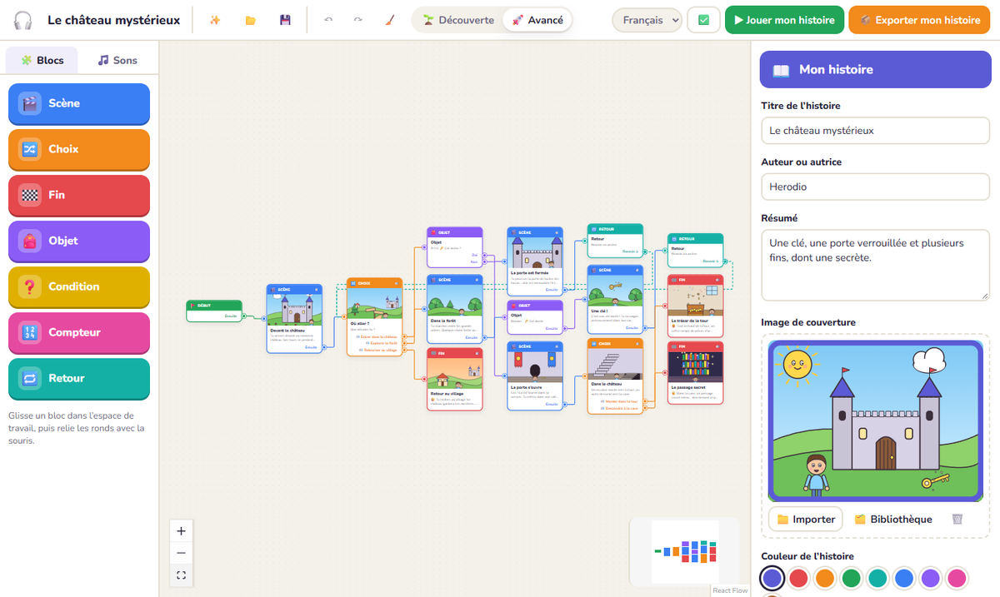
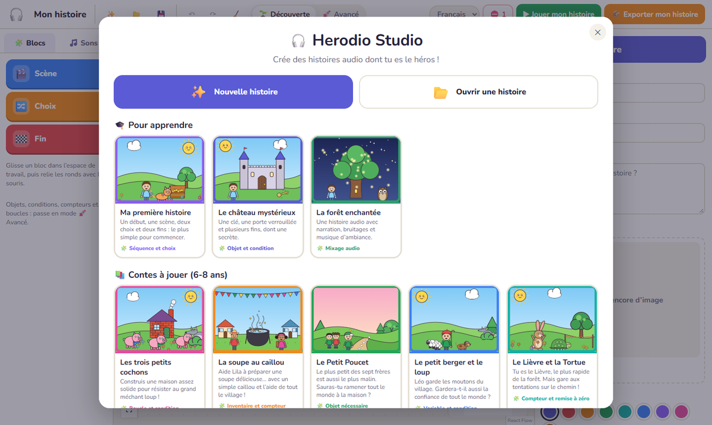
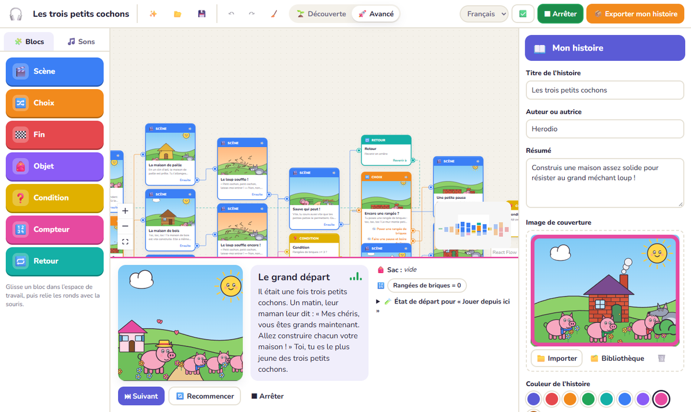
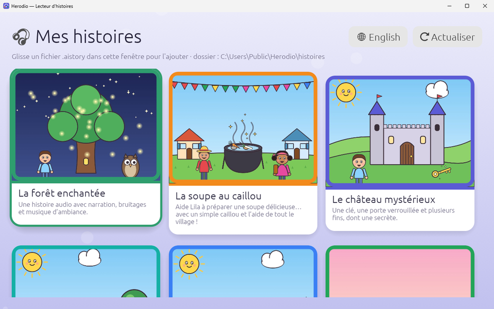
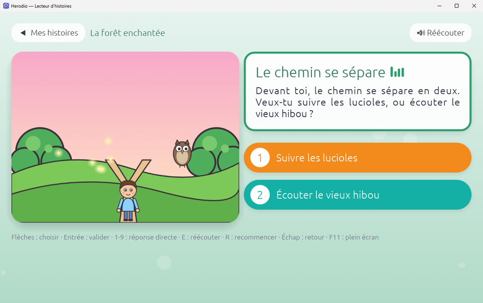
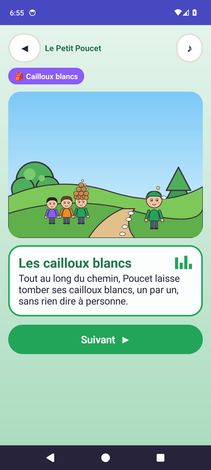

# Herodio — studio d'histoires audio dont tu es le héros

*[English version](README.en.md)*

Herodio permet à un enfant (de 7 à 14 ans environ), à un enseignant ou à un animateur de **créer une histoire audio interactive sans écrire de code**. On relie des blocs colorés, on enregistre sa voix, on ajoute des bruitages et une ambiance, puis on joue l'histoire. On l'exporte enfin vers un PC, un Raspberry Pi ou un téléphone Android, récent ou très ancien.

Tout fonctionne **hors ligne**, sans compte et sans abonnement.

> **Version 0.3.0-beta** : première version bêta, en français et en anglais. Le Studio et les lecteurs PC et Android sont testés ; le vrai Raspberry Pi n'a pas encore été essayé sur l'appareil ; les premiers essais sur un vrai Xperia Play et un smartphone ont mené aux correctifs Android de la 0.2.2, à revalider sur l'appareil (voir [État du projet](#état-du-projet)).

## Aperçu


<sub>Le Studio : on relie des blocs colorés pour construire l’histoire (ici « Le château mystérieux »).</sub>

<table>
<tr>
<td width="50%"><br><sub>L’accueil du Studio : 8 histoires prêtes à jouer ou à modifier.</sub></td>
<td width="50%"><br><sub>On essaie son histoire directement dans le Studio.</sub></td>
</tr>
<tr>
<td><br><sub>Le lecteur PC et Raspberry Pi : la bibliothèque.</sub></td>
<td><br><sub>Un choix à faire : le texte puis chaque réponse sont lus à voix haute.</sub></td>
</tr>
</table>

<p align="center"><br><sub>Le lecteur Android, ici sur Android 14 (il fonctionne aussi sur un Xperia Play sous Android 2.3).</sub></p>

## Télécharger

Tous les fichiers sont sur la page [Releases](https://github.com/RyoSaeba89/herodio/releases) :

| Fichier | Pour quoi faire |
|---|---|
| `herodio-studio-…-windows-portable.exe` | **Herodio Studio**, l'éditeur : un seul fichier à lancer, sans installation (Windows 10/11, WebView2). Voix française et anglaise, 8 histoires dans chaque langue. |
| `herodio-studio-…-windows-setup.exe` | Le même Studio en installateur, avec le moteur WebView2 de Microsoft inclus : il s'installe sans Internet sur un Windows 10 qui ne l'a pas encore (Windows 11 l'a déjà). |
| `herodio-player-…-windows.exe` | Lecteur pour PC Windows |
| `herodio-player-…-linux-x64.tar.gz` | Lecteur pour PC Linux |
| `herodio-player-…-raspberry-pi-arm64.tar.gz` | Lecteur pour Raspberry Pi 3, 4, 5 ou Zero 2 (Raspberry Pi OS 64 bits), avec les fichiers de démarrage automatique |
| `herodio-android-….apk` | Lecteur Android, de la 2.3 (Xperia Play) à la 14 |
| `histoires-pc-android-raspberry-pi.zip` | Les 8 histoires prêtes à jouer (PC, Raspberry Pi, Android récent) |
| `histoires-android23.zip` | Les 8 histoires allégées pour Android 2.3 |
| `stories-en-….zip` | Les mêmes 8 histoires en anglais, pour les mêmes appareils |

L'installation de chaque lecteur est décrite dans [docs/lecteurs.md](docs/lecteurs.md). `SHA256SUMS.txt` permet de vérifier les téléchargements.

## Ce qu'on peut faire

- **En français et en anglais** : au premier démarrage, le Studio et chaque lecteur demandent la langue de l'interface ; on peut en changer à tout moment. Les 8 histoires fournies existent dans les deux langues, chacune avec sa narration.
- **Éditeur de blocs** dans l'esprit de Scratch :
  - les blocs : Début, Scène, Choix et Fin, plus, en mode 🚀 Avancé, Objet, Condition, Compteur et Retour ;
  - glisser-déposer, liaison à la souris (lâcher une flèche dans le vide propose de créer le bloc suivant), menu au clic droit, zoom, rangement automatique ;
  - annuler / rétablir, sauvegarde automatique et récupération après une fermeture accidentelle.
- **Enregistrement au micro** sur chaque scène, question ou réponse : plusieurs prises, écoute immédiate, choix de la prise.
- **Studio audio** (« mini-Audacity » pour enfants) :
  - forme d'onde, sélection d'un morceau, couper, supprimer, garder seulement un morceau, déplacer ;
  - plus fort / moins fort, volume idéal (normalisation), apparition et disparition progressives, fondu enchaîné ;
  - pistes voix, ambiance et bruitage, avec muet, solo et volume ;
  - baisse automatique de l'ambiance quand quelqu'un parle (ducking).
- **Bibliothèque de sons et d'images** : import WAV, MP3, OGG, FLAC ou M4A, et PNG, JPEG, WebP ou SVG ; catégories ; préécoute ; glisser un son ou une image sur un bloc ; repérage des médias inutilisés.
- **Illustrations** : chaque scène, question ou fin peut avoir son image. L'histoire a aussi une couverture et une couleur. À l'export, les images sont converties en JPEG à la bonne taille pour chaque appareil.
- **Voix automatique** (désactivée par défaut) :
  - une voix de synthèse **libre et hors ligne** lit à voix haute les textes qui n'ont pas encore d'enregistrement : scènes, questions et réponses ;
  - elle repose sur [Piper](https://github.com/rhasspy/piper) : voix « Siwis » pour les histoires en français, « LJ Speech » pour les histoires en anglais (réglage « Langue de l'histoire ») ;
  - elle fonctionne dans la prévisualisation et elle est intégrée aux sons à l'export : **tous** les lecteurs en profitent, même Android 2.3 ;
  - le bouton 🗣️ d'un bloc la transforme en vraie prise, modifiable dans le studio.
- **« Jouer mon histoire »** avec le même moteur que les lecteurs :
  - le bloc en cours est mis en évidence et le chemin parcouru est surligné ;
  - le sac et les compteurs sont affichés ;
  - on peut jouer à partir de n'importe quel bloc, avec un état de départ choisi.
- **Vérification** en langage d'enfant : début manquant, flèche manquante, bloc jamais atteint, impasse, boucle infinie, objet jamais donné, son introuvable…
- **Export en un clic** vers 5 plateformes, avec estimation de la taille et conseils propres à chaque appareil.
- **8 histoires fournies**, toutes narrées, illustrées et sonorisées :
  - 3 pour apprendre l'outil : *Ma première histoire*, *Le château mystérieux*, *La forêt enchantée* ;
  - 5 contes du patrimoine pour les **6-8 ans**, étudiés puis adaptés en histoires interactives : *Les trois petits cochons*, *La soupe au caillou*, *Le Petit Poucet*, *Le petit berger et le loup*, *Le Lièvre et la Tortue*. L'étude et les choix d'adaptation sont dans [docs/histoires/analyse.md](docs/histoires/analyse.md).
- **Lecteurs illustrés et colorés** :
  - bibliothèque en cartes avec couverture ;
  - grande illustration et fond aux couleurs de l'histoire ;
  - réponses en grosses pastilles colorées et numérotées ; le texte puis chaque réponse sont lus à la suite, en surlignant ce qui est lu ;
  - fondu entre les scènes ;
  - confettis (fin heureuse) ou pluie d'étoiles (fin secrète).

## État du projet

Ce tableau distingue ce qui est écrit, compilé et testé :

| Composant | Implémenté | Compilé | Testé |
|---|---|---|---|
| Éditeur (Windows, Tauri) | ✅ | ✅ exe portable + installateur NSIS (WebView2 hors ligne inclus) | ✅ 84 tests unitaires (dont la couverture des traductions et les 16 histoires), tests de bout en bout dans Edge (création, logique, studio, export, enregistrement/réouverture, choix de la langue, retours de l'alpha), démarrage de l'exe vérifié ; ⚠️ enregistrement au micro non testé automatiquement |
| Moteur TypeScript (référence) | ✅ | ✅ | ✅ conformité |
| Lecteur Windows (Rust) | ✅ | ✅ | ✅ conformité, partie complète automatisée, rendu de la fenêtre vérifié par capture ; ⚠️ son, clavier et survol à la souris non essayés à la main |
| Lecteur Linux / Raspberry Pi (Rust) | ✅ | ✅ x86_64 Linux (WSL) et aarch64 (compilation croisée) | ✅ tests sur Linux x86_64 et sous émulation aarch64 (qemu), mode console joué sur les 8 histoires exportées ; **à valider sur un vrai Raspberry Pi** |
| Lecteur Android 2.3 → 14 (Java) | ✅ | ✅ APK signé v1+v2, compilé contre l'API 9 | ✅ émulateurs Android 2.3.7, 5.1 et 14 (import, lecture WAV, illustrations, D-pad, clavier, toucher, histoires complètes, confettis, rotation, réécoute) ; premiers essais sur un vrai Xperia Play et un smartphone, **correctifs de la 0.2.2 à revalider sur l'appareil** |
| Voix automatique (Piper : Siwis et LJ Speech, dans l'éditeur) | ✅ | ✅ | ✅ synthèse, cache, prévisualisation, prises et export testés dans Edge ; 8 s de parole calculées en 2 s environ ; narration anglaise des histoires générée avec LJ Speech |

## Architecture

```
editor/            Herodio Studio — React + TypeScript + React Flow + Web Audio, empaqueté avec Tauri 2
  src/engine/      moteur narratif de référence
  src/model/       projet éditable, compilation vers story.json, validation, édition audio
  src/audio/       mixage (prévisualisation ET export), lecture, enregistrement
  src/io/          fichiers .herodio, export des packs .aistory
  src/ui/          interface
  src-tauri/       application Windows (lecture et écriture de fichiers)
players/
  desktop/         lecteur Rust (egui + rodio) : Windows, Linux, Raspberry Pi (+ mode console)
  android/         lecteur Java sans dépendance, de l'API 9 à 34, compilé sans Gradle (build.py)
spec/
  story.schema.json   schéma du format exécutable
  conformance/        tests partagés par les 3 moteurs
docs/              formats, moteur, installation des lecteurs
tools/             génération des bruitages et musiques (gen_sons.py) et des illustrations (illustrations/)
editor/scripts/    installation de la voix (setup-tts.mjs) et narration des histoires fournies (gen-narration.mjs)
```

**Principe clé** : la plateforme partage le **format de données** et les **règles du moteur**, pas le code. Chaque lecteur est natif de son appareil : Java 6 pour Android 2.3, Rust pour le PC. Les mêmes tests de conformité garantissent qu'à état égal, une histoire prend les mêmes décisions partout. Voir [docs/moteur.md](docs/moteur.md).

L'audio est **prémixé à l'export** : un seul fichier WAV mono par moment de l'histoire, à la fréquence adaptée à l'appareil. Le mixage utilisé pour l'export est le même que celui de la prévisualisation. Voir [docs/format.md](docs/format.md).

### Inspiration : STUdio

[STUdio](https://github.com/marian-m12l/studio) modélise les packs Lunii :

- des **nœuds de scène** (image et son, avec des réglages de molette, OK, accueil et lecture automatique) ;
- des **nœuds d'action** (la liste des options) ;
- une conversion des sons au moment du transfert vers l'appareil.

Herodio en reprend trois idées :

- une **réponse peut avoir son propre son**, entendu quand on la surligne (comme la molette Lunii), ce qui rend les choix utilisables par un enfant qui ne lit pas encore ;
- la **lecture automatique** de la scène suivante à la fin du son ;
- la **conversion à l'export** selon l'appareil.

Herodio y ajoute ce que Lunii n'a pas : objets, conditions, compteurs, boucles explicites, un éditeur audio et des lecteurs ouverts sur 5 plateformes, sans dépendre d'un appareil propriétaire.

## Démarrer

```sh
# Éditeur
cd editor
npm install
npm run dev            # dans le navigateur : http://localhost:1420
npm test               # tests unitaires + conformité
npx tauri dev          # application Windows
npx tauri build        # exe + installateur dans src-tauri/target/release/

# Lecteurs : voir docs/lecteurs.md
```

Tests de bout en bout (Edge, sans fenêtre visible) : lancer `npm run dev`, puis `node e2e-smoke.mjs <dossier>`, `e2e-logic.mjs`, `e2e-studio.mjs`, `e2e-export.mjs`, `e2e-lang.mjs` et `e2e-title.mjs`. `HERODIO_LANG=en` les lance avec l'interface en anglais.

Traductions : le code est écrit en français et `t('…')` donne la traduction anglaise (`editor/src/i18n.en.ts`) ; un test vérifie qu'aucun texte n'est oublié. Les lecteurs font de même (`players/desktop/src/i18n.rs`, `players/android/common/org/herodio/core/I18n.java`). Les histoires anglaises sont dans `editor/src/stories/*.en.ts`.

## Licences

Détail des composants tiers : [THIRD_PARTY.md](THIRD_PARTY.md).

- Code : MIT ([LICENSE](LICENSE)).
- Histoires fournies (adaptations), illustrations, bruitages et musiques : créations Herodio, CC0. Les contes d'origine sont du domaine public.
- **Voix « Siwis »** (voix automatique et narration des histoires en français) : modèle Piper `fr_FR-siwis-medium`, entraîné sur les données SIWIS, licence **CC BY 4.0**. L'attribution est ajoutée automatiquement dans le `metadata.json` des packs.
- **Voix « LJ Speech »** (voix automatique et narration des histoires en anglais) : modèle Piper `en_US-ljspeech-medium`, entraîné sur les données LJ Speech, du **domaine public**.
- Moteur de synthèse : onnxruntime-web (MIT) et piper_phonemize (MIT), qui contient les données d'espeak-ng (**GPL-3**). C'est un composant séparé, chargé depuis `editor/public/tts/vendor/` ; texte de la licence dans [LICENSES/GPL-3.0.txt](LICENSES/GPL-3.0.txt).
